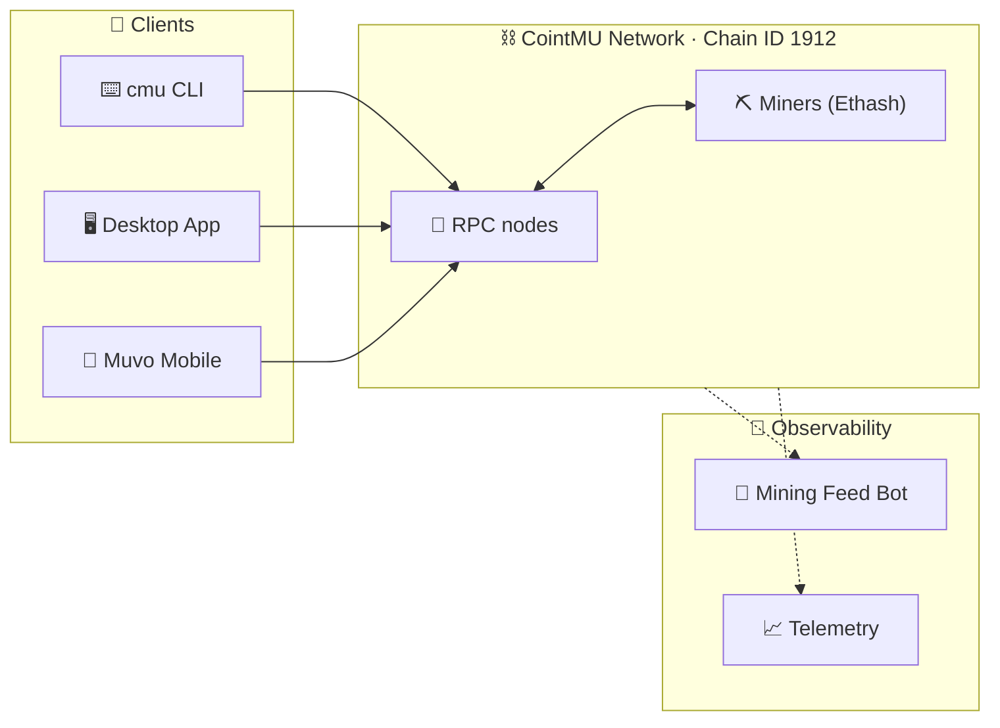

<div align="center">



<br>

[](https://coint-mu-docs.vercel.app)
[](https://www.npmjs.com/package/cointmu-cli)
[](#-network-at-a-glance)
[](#-network-at-a-glance)
[](https://github.com/Cointmu-ORG/CointMU-MobileApp)

**[🚀 Quick start](#-quick-start)** · **[🧩 Projects](#-projects)** · **[🏗️ Architecture](#%EF%B8%8F-architecture)** · **[🌐 Network](#-network-at-a-glance)** · **[🤝 Contributing](#-contributing)**

</div>

---

## ✨ What is CointMU?

CointMU is a **private, Ethereum-compatible Proof-of-Work blockchain** built at Universitas Muhammadiyah Yogyakarta (UMY). It's a hands-on playground: run a node, mine blocks, send transactions, deploy contracts, and watch it all happen from your laptop or your phone.

<table>
<tr>
<td align="center" width="25%">⛏️<br><b>Mine</b><br><sub>Feel real PoW mining, hash by hash</sub></td>
<td align="center" width="25%">👛<br><b>Wallet</b><br><sub>Desktop and mobile, you hold the keys</sub></td>
<td align="center" width="25%">🔍<br><b>Explore</b><br><sub>Blocks, transactions, node dashboard</sub></td>
<td align="center" width="25%">📜<br><b>Build</b><br><sub>Deploy Solidity contracts on a private chain</sub></td>
</tr>
</table>

---

## 🧩 Projects

| | Project | What it does | Stack |
|:-:|---|---|---|
| 🖥️ | **[CointMU-App](https://github.com/Cointmu-ORG/CointMU-App)** | Desktop app with a bundled Geth node, wallet, miner control, block explorer and node dashboard. Windows, Linux and macOS. |   |
| 📱 | **[CointMU-MobileApp](https://github.com/Cointmu-ORG/CointMU-MobileApp)** ✨ *new* | **Muvo**, a non-custodial mobile wallet for CointMU. Android and iOS. |    |
| ⌨️ | **[CointMU-CLI](https://github.com/Cointmu-ORG/CointMU-CLI)** | `cmu`, the command line for creating wallets, sending transactions and mining. |   |
| 📖 | **[CointMU-Docs](https://github.com/Cointmu-ORG/CointMU-Docs)** | Guides and references, live at [coint-mu-docs.vercel.app](https://coint-mu-docs.vercel.app). |  |
| 🤖 | **[CointMU-Bot](https://github.com/Cointmu-ORG/CointMU-Bot)** | Mining feed bot that announces new blocks on Telegram and Discord. |   |
| 📈 | **[CointMU-Telemetry](https://github.com/Cointmu-ORG/CointMU-Telemetry)** | Monitoring for the network: errors, logs, metrics and dashboards. |   |

---

## 🏗️ Architecture



---

## 🚀 Quick start

<details open>
<summary><b>⌨️ &nbsp;Command line</b> &nbsp;<sub>fastest way in</sub></summary>

<br>

```bash
npm install -g cointmu-cli
cmu create
```

Then follow the [CLI guide](https://coint-mu-docs.vercel.app) to connect to the network and start mining.

</details>

<details>
<summary><b>🖥️ &nbsp;Desktop app</b> &nbsp;<sub>wallet, miner and explorer in one window</sub></summary>

<br>

Grab the latest build for Windows, Linux or macOS from [CointMU-App](https://github.com/Cointmu-ORG/CointMU-App). The app bundles its own Geth node, so there's nothing else to install.

</details>

<details>
<summary><b>📱 &nbsp;Mobile wallet (Muvo)</b> &nbsp;<sub>Android and iOS</sub></summary>

<br>

Muvo is a non-custodial wallet, so your keys stay on your device. Setup and build instructions are in [CointMU-MobileApp](https://github.com/Cointmu-ORG/CointMU-MobileApp).

</details>

<details>
<summary><b>📜 &nbsp;Deploying smart contracts</b></summary>

<br>

> [!IMPORTANT]
> The chain has no `PUSH0` opcode, so compile with **Solidity ≤ 0.8.19**. Newer compilers emit bytecode that this network can't execute.

</details>

> [!TIP]
> New here? Start with the [docs](https://coint-mu-docs.vercel.app), then install the CLI and mine your first block.

---

## 🌐 Network at a glance

| | |
|---|---|
| 🆔 **Chain ID** | `1912` |
| ⛏️ **Consensus** | Proof of Work (Ethash) |
| 🧱 **Client** | Geth `1.10.26` |
| 📜 **Solidity** | `≤ 0.8.19` (no `PUSH0`) |
| 📖 **Connection details** | See the [docs](https://coint-mu-docs.vercel.app) |

---

## 🤝 Contributing

Contributions are welcome across all projects. Open an issue to discuss what you'd like to change, or send a pull request straight to the relevant repository. Each repo has its own guidelines and security policy, so please check there first. For security problems, report them privately instead of opening a public issue.

---

<div align="center">

<sub>Built with ⛏️ at <b>Universitas Muhammadiyah Yogyakarta</b></sub>

</div>
